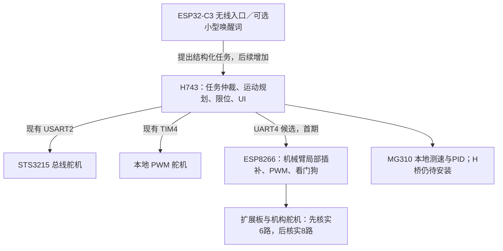

# H743 为核心的多控制器扩展规划

日期：2026-10-22。状态：调查与设计草案；没有修改 H743 或 ESP8266 固件，没有新增 UART 初始化、烧录或实物通信测试。用户确认无线板为 ESP32-C3；八舵机扩展板的完整型号/电路待确认。

建议第一步采用 **H743 + ESP8266 机械臂执行节点**。H743 保留统一任务、参数、界面、限位与动作授权；ESP8266 接收一组目标和运动时间，负责本机构的PWM输出与非阻塞插补。ESP32-C3 将来作为无线/语音意图入口，F103 暂作备用，不因手头有板就全部接入。

| 阅读问题 | 文档 |
|---|---|
| 为什么这样分工，算力是否浪费，AI放哪里 | [架构与取舍](01_架构分工与算力取舍.md) |
| 原ESP8266程序现在能做什么，需要怎样改 | [原程序审查](02_ESP8266现状与改造边界.md) |
| H743用哪个串口，怎么连线，有哪些资源冲突 | [资源与接线候选](03_H743资源与连接方案.md) |
| H743内部怎样解耦，节点用什么协议，怎样回复与失联处理 | [接口与通信草案](04_机构接口与通信契约草案.md) |
| 先做什么，怎样判定每一步完成 | [分期与验收](05_实施顺序与验收.md) |
| 本次查了哪些代码与官方资料 | [来源与核验](06_证据/来源与核验.md)、[机器可读证据](06_证据/调查记录.json) |

## 建议拓扑

所有“新增”都是规划项。H743 是控制核心，但失联保护不能只依赖核心：每个执行节点也要能独立停止接收新动作并执行预先验证的故障策略。

返回[硬件档案](../硬件档案/README.md)、[当前引脚矩阵](../整合交付/02_设备引脚与功能矩阵.md)、[现有指令手册](../指令手册/README.md)。
