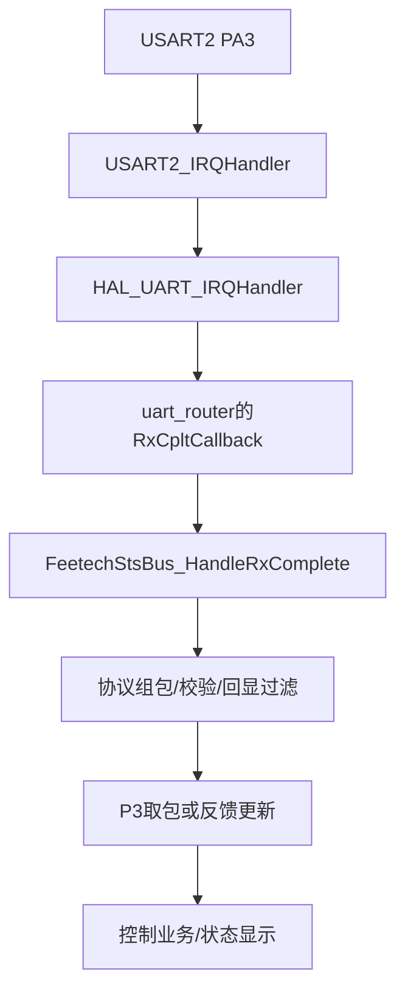

# 一个 STS 应答字节在本项目里经过哪里

## 先有资源，再有字节

[串口配置组](../../../project/App/platform/boards/lxb743zi_p1/board_serial_cfg.h)定义角色与完整硬件资源；[main](../../../project/Core/Src/main.c)按表声明句柄并调用BoardUart_ConfigureHardware；[MSP](../../../project/Core/Src/stm32h7xx_hal_msp.c)只转发，实际GPIO/RCC/NVIC由[H743后端](../../../project/App/platform/mcu/stm32h743/uart_backend.inc)按同一表配置。SERVO当前仍映射huart2/USART2，但更换角色配置不用在业务中搜索PA3。

`BoardUart_StartRxIT`检查RxState，清ORE并挂一字节接收。句柄与字节缓冲都长期存在。回调拿走字节后重新挂起，使下一字节仍能进入。

## 协议层拿到字节后做什么

[bus](../../../project/App/drivers/Servo/feetech_sts_bus.c)逐字节积累，检查帧头、长度、校验、回显，再更新原始包和feedback。只收到几字节不等于完整帧；发送回显也不等于舵机答复。

P3按状态等待PING/ID/型号/速率/限位应答，依据当前操作检查包长与ID。通过后周期读取反馈。故障时仍保留超时/错误计数，不通过写EEPROM强行“修好波特率”。

## 业务层接管的条件

App仅在P3达到ONLINE且报告ID等于配置ID时调用 `App_StartMotionStack`，初始化原bus/control/command。此后命令层处理原业务。只读识别到其他ID不会自动把原ID0控制层交过去。

这是一种“已确认设备身份后交接”的思路。它不证明本次实物已在线；先前现场rawRx仍为0。供电、TTL适配器与线路须先复验。

## 读日志时先分指标

rawRx是原始字节，valid/P3 rx是被接受的应答，parser是底层解析错误，tx是发送次数。te混合了某些发送/遥测入队失败，不等同于硬件奇偶错误；pe也不能凭缩写就解释成Parity Error。

实验：对照 [P3打印字段](../../../project/App/modules/servo_p3/servo_p3.c) 与 [STS扩展状态](../../../project/App/modules/integration/integration_service.c)逐项写出定义，再分析现象。字段名相似不是同一个计数器的证据。
