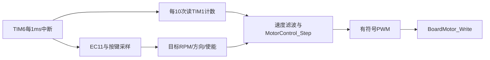

# EC11 动作如何变成电机控制量

## 初始化与真实时基

Integration_Init调用 `MotorService_Init`。服务把motor_config组成MotorConfig，板级初始化TIM1与输入GPIO、TIM6；若有已配置驱动才启用TIM12输出。当前driver=0，因此可以建立输入采样，但启动会被拒绝。

1ms来自硬件TIM6。`TIM6_DAC_IRQHandler`直接转发 `BoardMotor_Irq`，清UPDATE标志后调服务。它不走通用TIM周期回调，这一点要与UART的HAL回调路径区分。

## 旋钮、按压和反馈

[Tick1ms](../../../project/App/modules/motor/motor_service.c)读EC11两位，Gray解码每格±5RPM、范围0–400；PC13去抖20ms，短按释放换向，长按800ms启停，长按松开不再短按。

每10次采样读TIM1，处理16位回绕和反馈符号。霍尔13PPR、减速比20.409、四倍频CPR1061.268，传给纯C控制器。EC11格数不是电机CPR。

## 控制器内的关键分支

未使能或故障时输出零；需要换向时先停稳；零目标清积分；正常状态走斜坡、PID与限幅；之后检测反馈/符号异常。输出的正负代表驱动方向，绝对值为千分比占空比。

[Write](../../../project/App/platform/board_motor.c)根据驱动profile解释这个数。当前profile0直接不做动力输出，不是通过把目标设成0假装有驱动。

## 上层如何操作与读状态

`@motor rpm N`改目标，`enable/stop/reverse/clear`做明确状态转换；`pid/cpr/zero`仅停机允许。快照复制保存/恢复PRIMASK，主循环读取多字段时避免被ISR更新一半。

LCD第二行给目标/实际方向故障，串口rpm10为RPM×10，cpr1000为CPR×1000。不要把950‰打印成950%占空比。

当前只完成软件、模型与编译，缺H桥/实机调参。学习算法先运行 [模型测试](../../../Tools/run_motor_tests.py)；真实接线和启停前置条件见 [电机工程记录](../../电机控制/README.md)。
