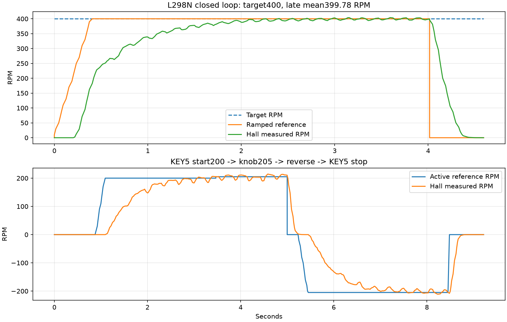

# MG310电机闭环验收与代码入口（2026-10-24）

## 当前结论

本轮实际串口数据验证了持续运行、霍尔反馈、闭环调速、模拟按键启停、模拟旋钮调速、换向及停机。不是仿真结果。当前已烧录修正版：反馈符号-1、参考斜坡1000RPM/s，默认PID仍为Kp=1.8、Ki=5、Kd=0。临时固定PWM诊断代码已撤下，正式控制器的300ms净进展、方向、超速与调度保护保留。

| 实测操作 | 目标RPM | 末段平均实际RPM | 结果 |
|---|---:|---:|---|
| 直接命令持续运行4秒 | 400 | 399.78 | 无故障；最高约404.02 |
| 模拟KEY5启动 | 200 | 198.02 | 持续运行 |
| 模拟旋钮+1格 | 205 | 208.78 | 目标增加5 |
| 运行中换向 | -205 | -202.27 | 先滑行，再反向 |
| 模拟KEY5停机 | 0（有效参考） | -0.018 | on=0、PWM=0 |

这些是短时台架结果，不能代替长期运行、负载扰动、热稳定性和独立转速仪校准。RPM按厂家13PPR×4×20.409=1061.268计数/输出轴转换算，未独立测量CPR。实体按钮和实体SM0488050旋钮本轮未人工操作，验证的是模拟输入经过共同消抖/业务路径。KEY6单/双击本轮没有额外做实物操作。



## 问题与修正记录

1. 用户本轮确认：之前把PWM线接到了PE13，随后改回PB14。PE13是旧TB6612配置的STBY预留脚；当前L298N的ENA必须接PB14。此前软件显示PWM不等于ENA实际收到PWM。因此“主要是斜坡太慢导致不起转”只是先前推断，不能作为已确认根因。
2. 改线后的独立诊断：固定70%PWM约1秒，连续收到约210～226RPM的负反馈，累计原始计数-3720。正向输出与原始TIM1计数符号相反，实测支持将MOTOR_ENCODER_SIGN从+1改为-1。无需再次交换A/B线。
3. 参考斜坡由150改为1000RPM/s，0到400参考值约0.4秒。该项是启动参数调整；本轮同时存在用户改线和符号修正，不能通过本轮试验单独量化斜坡修改的必要性。
4. 正式PID未提高，仍1.8/5/0。旧失败记录、原源码、诊断源码、构建/烧录日志、HEX、读回比较均保留。第一次修正版测试发生在开机未就绪时，未发送运动命令，另存为“修正版启动未就绪_未发运动命令.json”。

## 当前接线（两组A/B不要混淆）

| 功能 | H743/驱动连接 | 作用 |
|---|---|---|
| L298N ENA | PB14 / U9-45，拔ENA跳帽 | TIM12_CH1 PWM，20kHz |
| L298N IN1 | PE10 / U9-37 | 正反方向输入1 |
| L298N IN2 | PE12 / U9-39 | 正反方向输入2 |
| 电机M+、M- | L298N OUT1、OUT2 | 动力输出，不接MCU GPIO |
| 霍尔A | PA8 / U10-47 | TIM1_CH1，旧PE9留空 |
| 霍尔B | PE11 / U9-38 | TIM1_CH2 |
| 编码器VCC/GND | 板+5V / 共地 | 当前5V接法；PA8/PE11数字输入无内部上下拉 |
| L298N VS/VM | 用户报告10.3V独立动力电源 | 与逻辑电源区分；本轮未用万用表复核 |
| L298N逻辑 | 保留模块5V-EN稳压跳帽 | 模块5V端不接H743的3.3V |
| PE13 | 当前不接 | 不能当作本配置PWM |

IN1/IN2是输出控制；霍尔A/B是输入测速。原始计数递减经符号-1转换后，对应软件正转。

## 在VOFA上使用

COM9、115200、8N1对应本次CH340串口链路；选择JustFloat协议，8通道。命令按行发送，末尾CRLF，连续命令间隔建议至少200ms；开机先等待设备初始化完成、能回复@motor status再启动。

停止时先发送以下命令，一行一条：

```text
@motor status
@input mode mixed
@debug sts off
@debug motor on
@motor rpm 400
@motor plot on
```

再通过`@key 5 tap`启停；`@key 7 tap`也是启停，`@key 7 press 1200`长按换向。`@motor reverse`是直接换向命令。`@knob -1`/`@knob 1`每次改变5RPM；到400上限后再增加不变。KEY6单击减5、双击加5；双击需两次tap，约200ms间隔，详情见[复用操作手册](../../20261023_复用授权与VOFA/操作手册.md)。

绘图CH0=请求目标带方向、CH1=滤波实际RPM、CH2=有效斜坡参考、CH3=原始测速、CH4=有符号PWM千分比、CH5=CH2-CH1、CH6=启用、CH7=故障码。停机时CH0保留设定，CH2归零。绘图独占HOST输出，命令仍能接收，文字应答被抑制，避免破坏JustFloat。先`@motor disable`停机，再`@motor plot off`恢复文字帮助；`@quiet`只关打印，不等于停机。

上电调试授权默认OFF；离开DEBUG页保持授权，复位后关闭。若同时授权舵机和电机，复用键会广播到两者。本轮测试关闭舵机授权，未发送舵机运动命令。

## 电机代码入口

以下路径相对H743工程根目录，点击可打开实际文件：

| 文件 | 职责 |
|---|---|
| [motor_config.h](../../../../project/App/config/motor_config.h) | 驱动profile、反馈符号、CPR、PID、限速、参考斜坡 |
| [board_devices.h](../../../../project/App/platform/boards/lxb743zi_p1/board_devices.h) | 引脚/定时器/复用宏 |
| [board_motor.c](../../../../project/App/platform/board_motor.c) | BoardMotor_Init配置GPIO、TIM1编码器、TIM12 PWM、1ms中断；BoardMotor_Write设置方向和占空比 |
| [motor_control.c](../../../../project/App/modules/motor/motor_control.c) | 10ms计数差→RPM→滤波→PID→限幅与故障保护 |
| [motor_service.c](../../../../project/App/modules/motor/motor_service.c) | 1ms调度、10ms控制、反馈符号、旋钮/按压、启停和参数接口 |
| [motor_plot.c](../../../../project/App/modules/motor/motor_plot.c) | 8通道JustFloat打包 |
| [integration_console.c](../../../../project/App/modules/integration/integration_console.c) | @motor、@key、@knob等命令解析 |
| [integration_service.c](../../../../project/App/modules/integration/integration_service.c) | MotorService_Init等模块初始化入口 |
| [run_motor_tests.py](../../../../Tools/run_motor_tests.py) | 控制器/服务主机回归，不代替实物测试 |

底层链路：MotorService_Init→BoardMotor_Init；定时器中断→BoardMotor_Irq→MotorService_Tick1ms→每10ms读取TIM1计数差并乘MOTOR_ENCODER_SIGN→MotorControl_Step→BoardMotor_Write。只想改引脚，优先改board_devices.h；只想改符号/参数，改motor_config.h。

## 你提到的舵机代码

MG310是霍尔直流电机；STS3215是另一套串行总线舵机。两套入口同时列出，避免找错：

- [servo_p3.c](../../../../project/App/modules/servo_p3/servo_p3.c)：舵机业务状态机。
- [feetech_sts_control.c](../../../../project/App/drivers/Servo/feetech_sts_control.c)：舵机运动/读取控制。
- [feetech_sts_command.c](../../../../project/App/drivers/Servo/feetech_sts_command.c)：舵机控制命令。
- [feetech_sts_bus.c](../../../../project/App/drivers/Servo/feetech_sts_bus.c)：飞特总线帧收发。
- [feetech_sts_port.c](../../../../project/App/drivers/Servo/feetech_sts_port.c)：UART适配。
- [feetech_sts_register.h](../../../../project/App/config/feetech_sts_register.h)：寄存器表。
- [app_main.c](../../../../project/App/app_main.c)：ServoP3_Init等应用入口。

## 证据与版本边界

[400运行原始报告](修正后400实际运行.json)、[400CSV](修正后400波形.csv)、[启停/调速/换向报告](启停调速换向实测.json)、[独立固定PWM诊断报告](固定PWM实测.json)、[独立读回比较](修正版独立核验.json)。修正版HEX为本目录H743_L298N_反馈符号修正_快斜坡.hex；普通主配置构建0错误0警告，已烧录并经Cube校验，另独立比较153605个HEX数据字节，0差异。本轮不声称另两个摄像头构建配置已重新构建或烧录。
