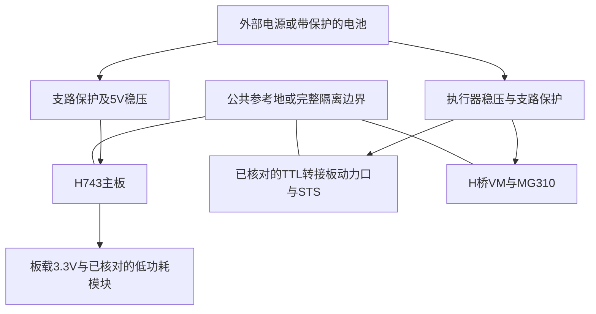

# 从 USB 供电到独立整机电源

## 开发板实际允许怎样供电

板卡自带“供电说明.png”写明推荐 5V 或 USB，经板上稳压得到 3.3V；另一条是外部稳定 3.3V 直接供电，两种路线选择一种。原理图 U13 为 RY3420，输入网络为 +5V，USB VBUS、H1 +5V 和扩展 +5V 标同名网络。依据见[资料来源 S01/S02](../04_资料与证据/01_来源与待确认项.md)。

| 入口 | 本项目采用的额定值/范围口径 | 使用限制 |
|---|---|---|
| Type-C VBUS / 板上 +5V | 稳定 5.0V；选合格稳压 5V 电源 | 工程选型目标可设 4.75–5.25V，但这是建议输出精度，**不是已确认整板全范围保证** |
| 板上 3.3V 直接输入 | 稳定 3.3V，带过压/限流的电源 | 绕过板上降压；若不了解反向供电路径，优先选 5V 入口 |
| GPIO、VREF、VBAT、VCAP | 均不是通用整板动力输入 | 不把相邻排针误当电源入口 |

没有依据把该开发板当“7–12V 输入开发板”。RY3420 芯片本身可能允许的输入范围，不代表整板所有同名 +5V 负载、USB 端口和保护件都允许相同范围。当前明确不采用 7.4V、8.4V、9V、12V 直接进 +5V/USB。Type-C CC 下拉是连接识别条件，不是 PD 高压协商控制器；不要人为用诱骗器把高压送入本板。

板卡说明还限制外供 3.3V 负载不超过 500mA。它是对外输出上限，不能解释为任何工况下都还有 500mA 余量；还要看主电源、模块总负载、稳压温升和线损。也不能据此用 3.3V 排针驱动电机或舵机。

## 当前 USB 与未来电源的区别

当前 USB 能带动板卡和视觉预览，不证明能承受电机起动或舵机负载。USB 端口、线材和供电设备的可用电流必须按实际规格确认，不能从 Type-C 外形推断有 3A。

建议先形成两类支路：逻辑支路提供稳定 5V 给主板；动力支路提供符合执行器范围的稳压输出，分别接 H 桥 VM 和舵机电源输入。蓝牙、编码器按各自接口电压供电。

图中动力稳压是否可共用，要以电压交集、电流、动态压降和干扰实测决定。分支供电不等于电气隔离。普通非隔离 UART/PWM/编码器连接需要公共参考地；大电流回路直接回到电源分配点，避免穿过主板 GND 排针形成回流路径。

## 可以怎样选后续电源

**台式调试：** 主板继续单独 USB 或 5V 稳压；执行器用可限流的台式电源，先按标称电压和低风险空载流程逐个验证。串联负载不等于串联电源，不能把主板和电机串在同一回路。

**有线整机：** 可选合格的较高电压直流适配器，再使用足额 DC-DC 输出逻辑 5V、舵机 6–7.4V、MG310 优先 7.4V。上游 12V 仅是一个架构例子，最终不得把它直接接入主板或据此认定所有执行器支持 12V。

**电池整机：** 先记录电池化学体系、串数、充满/截止电压和保护能力。常见普通锂离子 2S 为标称 7.4V、满充 8.4V；不能据此认为是固定 7.4V 电源。若输出要在电池下降后仍保持 7.4V，普通降压器不够，需要合适升降压方案，或重新定义供电/停机范围。BMS 不是稳压器；单节升压、3S 降压也要核对峰值电流、效率、热和输入极限。[电池厂商依据见 S08](../04_资料与证据/01_来源与待确认项.md)。

## USB 与外部供电同时连接

原理图中 USB VBUS 与 +5V 同网，未据此确认有 USB 电源选择/防回灌器件。外部 5V 接入时又插电脑 USB，可能直接并联两个源。ST-Link/USB-TTL 若再接电源输出也可能形成第三路。

调试前确定谁是唯一主供电源；使用有明确防回灌/电源切换设计的连接方案。自供电 USB 仍需满足 VBUS 检测和枚举条件，不能把剪 VBUS 当作无需核对电路的通用办法。保留哪些数据线、VTref、地和电源线，应按调试器及本板原理图确定。

## 隔离要求怎样理解

本板原理图对电机/高干扰设备明确提出光耦隔离要求，这是厂商针对本板的建议，不能把“共地”当作已经满足隔离。若按完整隔离设计，应同时考虑控制信号、编码器反馈和隔离侧供电；只隔离一根 PWM、再用 UART/GND 跨接会破坏隔离边界。20kHz PWM 和编码器信号还要求隔离器带宽及延迟合适。没有确定 H 桥/隔离接口前，功率连接仍是待设计项。
