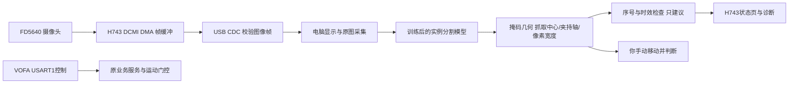

# 电脑识别、H743集成、手动验证的职责

## 为什么先这样分工

当前摄像头通过DCMI和DMA得到240×240 RGB565帧；H743已经承担屏幕、输入、总线舵机及电机服务。首版将训练和分割推理放在电脑，H743负责采集、传输、接收建议和状态显示。这样不必先把模型量化并挤入MCU，也保留以后部署轻量模型的接口边界。

已读取这台电脑的nvidia-smi：RTX 4060 Laptop GPU，8188MiB显存；Windows显示接口对AdapterRAM的4GB结果不作为实际显存依据。当前已安装隔离的预览环境；训练环境与CUDA可用性仍需按训练手册安装核验。

USB CDC与USART1是两个不同COM设备：图像走USB数据口，VOFA保留USB-TTL连接的USART1。图像不进入原FF帧解析或USART1发图路径。JDY-31当前项目UART为9600baud；单帧115200字节，即使不算协议开销，8N1串口也约需120秒，不能作为这一设置下的实时视频替代。后续无线可考虑独立WiFi节点，但本版未改ESP项目或蓝牙配置。

## 深度学习与抓取算法分别做了什么

模型学习“哪块图像是箱体/黑包裹”，输出实例掩码。代码再用掩码主轴与内部安全中心产生平面夹持候选，检测裁切、方向歧义、邻近已识别物体冲突，并要求连续4次建议稳定。它是“学习识别+几何抓取建议”，不是已经训练好的抓取质量网络。

绿色线表示一个通过当前二维筛选的候选，不代表已经验证夹持力、摩擦、软包变形、背面支撑、三维碰撞或实际成功率。正方形等主轴不稳定目标会暂时拒绝；黑袋褶皱、透明胶带反光和遮挡需要真实样本与人工复核。模型也不能保证所有障碍物都被识别出来。

## 手持摄像头的坐标边界

当前输出原始图像坐标u/v（向右/向下）、夹爪闭合方向angle、像素开口width；没有Z深度和毫米坐标。屏幕/电脑视图可按相机的旋转、镜像显示，但算法和回传始终用原始传感器坐标，不能把显示翻转后的点直接送回。

摄像头随手运动时，固定桌面单应性标定会失效。因此首版不输出“向前移动多少毫米”，不生成机械臂关节轨迹。连续稳定只表示图像建议稳定，也不是机械手已固定的证明。下一阶段有真实机构后，需相机内参、相机到夹爪的外参、深度或已知目标尺度、夹爪开口标定、碰撞与力控验证，才讨论三维自动抓取。

H743当前接收接口只更新VisionAdvice，不调用任何舵机、电机动作，也不修改控制权。原自动夹取菜单仍为未实现，不能用电脑候选到达就启用该动作。
