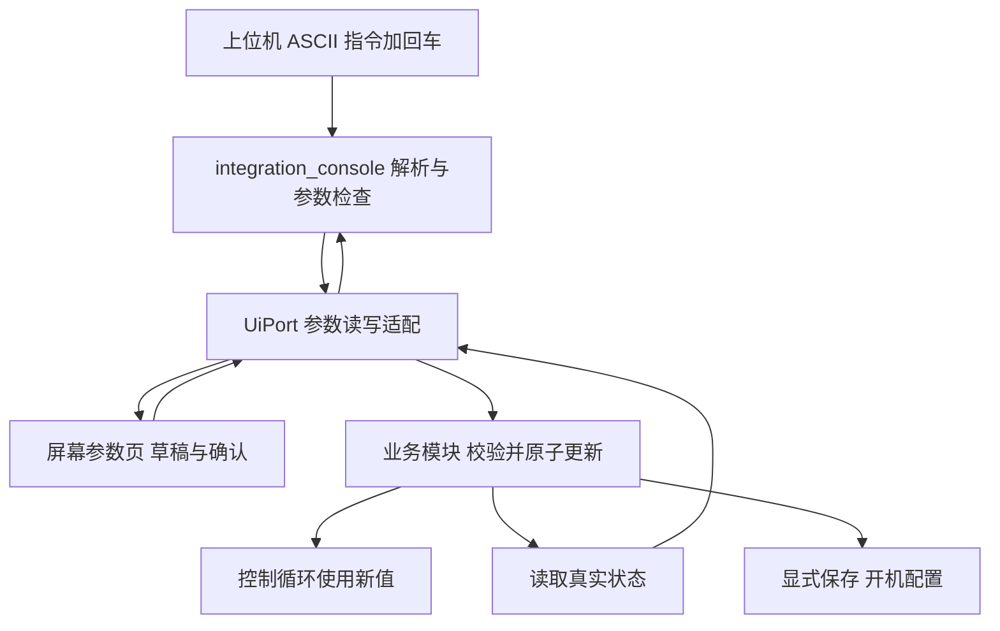

# 配置一个可供上位机控制的参数，需要经过哪些设置

## 一、先判断你要增加的是什么

“目标转速”“PID增益”是参数，有当前值、单位、范围和写入规则；“夹取”“拍照”是执行动作；“实际转速”“故障码”是只读反馈；“按钮按下”是输入事件。它们不能都做成可任意写的全局变量。参数写入必须最终到达真正使用它的业务模块。

本项目的传递关系如下。物理串口、USB和屏幕是入口，业务状态只有一份。



只增加一个已有类别的参数，不需要重新配置UART、注册新的中断或复制一套串口解析。相关硬件初始化仍由平台层负责；新的电气外设才需要沿硬件适配流程配置引脚、时钟、IRQ等。

## 二、完整追踪一个现在能用的参数：Kp

当前ID22名为`KP_milli`，整数1800代表Kp=1.8。采用整数传输，可避免上位机小数格式、显示与解析不一致。它的当前值来自电机服务快照，不来自屏幕缓存。

1. 发送`@param get 22`并回车，查看值、范围及状态。
2. 在停止电机后发送`@param set 22 1800`并回车。当前增益范围为0–100000，参数单位为实际增益的千分之一。
3. [文本控制台](../../../project/App/modules/integration/integration_console.c)严格解析ID和值，先读取当前值，再通过`UiPort_Operations()`的`parameter_write`提交。越界、非法整数、多余参数或溢出都应拒绝。
4. [ui_port.c](../../../project/App/modules/ui/ui_port.c)的`ParamRead`提供value/min/max/step/factory；`ParamWrite`比较预期旧值和当前值，再调用`MotorService_SetPid`。修改Kp时保留当前Ki/Kd。
5. [motor_service.c](../../../project/App/modules/motor/motor_service.c)中的业务接口验证范围和停机条件，将整数除以1000更新控制配置。共享状态在适当的中断保护下访问，不能靠普通全局变量赋值替代。
6. 再次get确认实际值。屏幕下一次读取也会看到同一值。需要下次上电仍使用它，再执行`@profile save`；单次set只改变运行配置，不自动保存或使能电机。

`@motor pid 1800 5000 0`是同时设置三项的专用入口；通用参数接口是逐项读写。二者都应落到同一电机服务，不能各存一份增益。无H桥时驱动配置仍为0，设置增益不代表电机已可启动。

## 三、新增参数的实际修改顺序

以下用“电机目标变化斜率”说明设计步骤，名称`MOTOR_RAMP`、未来ID25仅为教学提案，**当前固件不存在该参数和对应命令**，也尚未实现斜率控制。

| 步骤 | 修改责任 | 为什么需要 |
|---|---|---|
| 1 定义契约 | 确定单位、范围、工厂值、允许写入状态、保存策略 | 例如RPM/s与RPM/周期不能混用；0代表关闭还是禁止必须明确 |
| 2 实现业务 | 给电机配置和快照增加字段，设计真实setter与验证；控制循环按固定周期使用它 | 只有界面字段而没有控制算法，电机行为不会变化 |
| 3 完成并发与恢复 | setter使用现有锁/维护规则，维护或停机恢复原路径；复位设置工厂值 | 避免ISR读到半更新状态，避免保存中被改写 |
| 4 接入UiPort | 追加名称、读值元数据和写入分支，更新总数与边界 | 屏幕和通用文本接口才能找到新ID |
| 5 设计保存 | 根据第三篇修改采集、验证、应用与版本兼容 | 不是增加一个Flash字段就能自动恢复 |
| 6 补齐资料与验证 | 参数表、帮助、快捷配置、测试和文档 | 上位机能发现、能发送，也能判断是否成功 |

步骤4特别容易遗漏：当前`params[]`有25个名字；`ParamName`使用`id<25`，`ParamRead`使用`id>24`边界，`ops`首项为25。新增参数时必须检查所有这些位置，以及读写switch/分支。仅把总数改26会让不存在的后台字段冒充有效参数。可在未来实现时集中定义数量以减少遗漏，但这篇文档没有改动代码。

现在ID0–20属于STS参数，21–24是电机参数。新增设备参数宜追加稳定ID，不要往中间插入并挤走原编号。若增加STS内部枚举，还要明确它与UI ID的转换：不能让STS新的21与现有电机RPM的21碰撞。原F2/F3只处理其原STS参数空间，不会因为通用UI新增参数就自动扩展。

## 四、读写接口应该保证什么

读接口返回真实快照、范围、步长、工厂默认值以及状态。步长为0表示当前接口只读；离线时不能伪装成正常在线值。写接口重新验证状态和范围，并用expected旧值检查竞争：屏幕打开编辑后，上位机可能已修改同一参数，此时应返回CHANGED，请用户重新编辑，不能静默覆盖。

当前结果编号为0受理、1离线、2忙、3禁止、4原值变化、5失败，UI还有6未实现。成功只表示该接口受理；还要读回状态证明真实值。运行目标RPM允许调整不等于增益允许运行中修改，不能在通用解析器里统一放宽业务限制。

文本参数采用有符号32位整数。若实际量为浮点，明确缩放和舍入；先验证范围，再转换类型。业务setter和控制循环都要防溢出，尤其是将RPM/s乘时间或缩放倍数时。维护期间不得借新增入口绕过停止、故障和驱动就绪检查。

## 五、在工程里怎样找代码

在H743目录中使用搜索，不依赖记住文件行号：

```powershell
rg -n 'KP_milli|ParamRead|ParamWrite|UiPort_Operations' project/App
rg -n 'MotorService_SetPid|MotorService_Snapshot|ResetParameters' project/App
rg -n 'parameter_count|parameter_write|@param' project/App/modules
```

先查接口声明理解参数，再看实现和调用者。需要HAL时才查统一HAL头、平台与BSP；参数业务层不应该直接选择huart句柄或GPIO。新增独立C/H文件时，还要登记实际IAR工程各配置的编译输入，而不只放入磁盘目录。

继续阅读[屏幕接入](02_屏幕与按键映射教学.md)和[保存流程](03_开机保存与兼容.md)。
